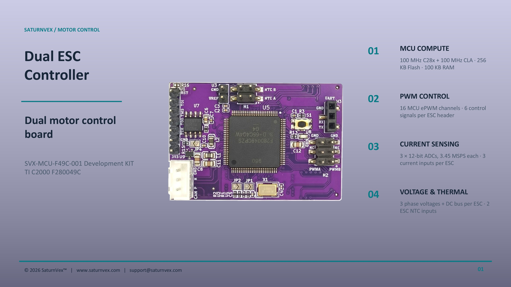
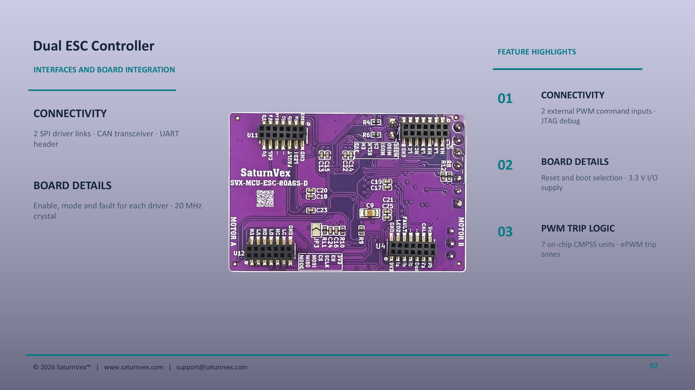
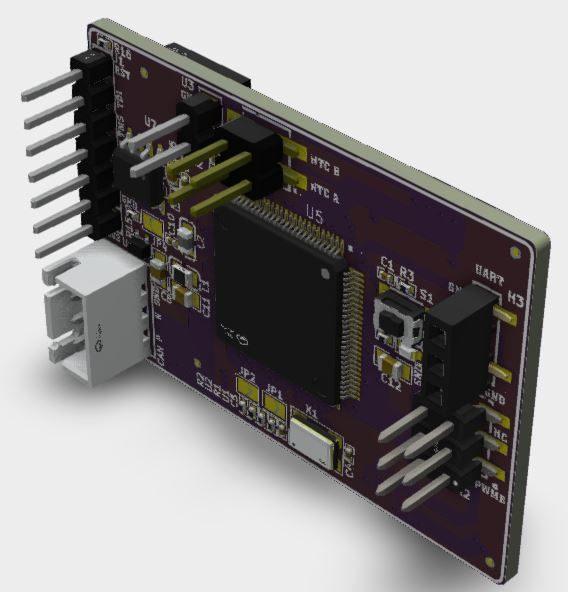

<strong>SATURNVEX · MOTOR CONTROL</strong>

<!-- Two full-width cover images; GitHub constrains content to the README panel width. -->

# SVX-MCU-F49C — Development Kit

*SaturnVex™ — embedded hardware, firmware and Edge AI platforms*

A compact TI C2000 TMS320F280049C controller board for dual-motor (2 × PMSM, sensorless FOC) ESC development: twelve gate-drive PWM outputs, sixteen current / voltage / temperature sense inputs, CAN, UART and two PWM command inputs on one board.

This Dev Kit is not limited to motor control: it can be reconfigured for other applications using the MCU pins fanned out to the on-board headers (see the pin map).

## Product specifications

| Item | Specification |
|---|---|
| Product code | `SVX-MCU-F49C-001` |
| MCU | TI TMS320F280049C (F280049CPZS, 100-pin LQFP), C28x DSP with FPU / TMU, 100 MHz, plus 100 MHz CLA |
| Memory | 256 KB Flash, 100 KB RAM |
| Clock | 20 MHz crystal (X1), SYSCLK 100 MHz |
| Board dimensions | **47.6 × 32.3 mm (PCB, 4-layer)** |
| Supply | 3.3 V single supply from the power board (board-to-board connectors) or J1 pin 1; no on-board regulator |
| Motor PWM | 12 gate-drive outputs (INH / INL × 3 phases × 2 motors) on EPWM1 – EPWM6, 500 ns dead time |
| Analog sensing | 3 × 12-bit ADC (3.45 MSPS each): 3 phase currents, 3 phase voltages and DC bus per motor, 2 NTC inputs (16 channels) |
| Gate-driver interface | SPI link (SPIA / SPIB), enable, mode, calibration and fault signal for each driver |
| Communication | CAN 2.0 via SN65HVD234 transceiver with ESD protection (CN1), optional 120 Ω termination (JP4); debug UART (H3) |
| Command inputs | 2 PWM inputs (H2) measured by eCAP |
| Protection logic | 7 on-chip CMPSS comparators, ePWM trip zones |
| Debug & boot | 7-pin JTAG header (J1), reset switch S1, boot-mode solder jumpers JP1 / JP2 |
| Power-board interface | Four 2 × 7, 1.27 mm board-to-board connectors (U11 / U12 motor A, U4 / U6 motor B) |
| Test projects provided | PWM & LED, 16-channel ADC, PWM input capture & UART, CAN 2.0 with STM32G474 partner |

## Documentation

| Resource | File |
|---|---|
| **Board quick configuration guide** | [Open PDF](docs/SaturnVex_SVX-MCU-F49C-001_Quick_Configuration_Guide_EN.pdf) |
| **Firmware test guides and source projects** | [Browse tests](tests/README.md) |
| **Mechanical CAD (47.6 × 32.3 mm)** | [CAD files / STEP](cad/README.md) |
| **Download all available documentation and code** | [Download complete package](downloads/SVX-MCU-F49C-001_Complete_Resources.zip) |

## Test projects — documentation paired with source

| Test | Test guide (PDF) | Source (ZIP) | Overview |
|---|---|---|---|
| 01 — LED & Gate-Drive PWM | [Guide](tests/01-pwm-led/SaturnVex_F280049C_PWM_LED_Test_Guide_EN.pdf) | [Source](tests/01-pwm-led/F280049C_PWM_LED_Test_SaturnVex.zip) | [Open](tests/01-pwm-led/README.md) |
| 02 — 16-Channel ADC Measurement | [Guide](tests/02-adc-16ch/SaturnVex_F280049C_ADC_Test_Guide_EN.pdf) | [Source](tests/02-adc-16ch/F280049C_ADC_Test_SaturnVex.zip) | [Open](tests/02-adc-16ch/README.md) |
| 03 — PWM Input Capture & UART | [Guide](tests/03-pwm-capture-uart/SaturnVex_F280049C_PWM_Capture_Test_Guide_EN.pdf) | [Source](tests/03-pwm-capture-uart/F280049C_PWM_Capture_Test_SaturnVex.zip) | [Open](tests/03-pwm-capture-uart/README.md) |
| 04 — CAN 2.0 with STM32G474 | [Guide](tests/04-can-stm32g474/SaturnVex_F280049C_CAN_Test_Guide_EN.pdf) | [Source](tests/04-can-stm32g474/F280049C_CAN_Test_SaturnVex.zip) | [Open](tests/04-can-stm32g474/README.md) |

**Getting started:** Read the [Quick Configuration Guide](docs/SaturnVex_SVX-MCU-F49C-001_Quick_Configuration_Guide_EN.pdf) before powering the board, flashing or connecting a CAN network. Each test project has its own setup and acceptance criteria. Projects are built with Code Composer Studio and TI C2000Ware 26.01.00.00.

## CAD data

**Nominal PCB dimensions: 47.6 × 32.3 mm.** Download the original [STEP model](cad/SVX_MCU_F49C_KIT_001.step) for mechanical integration.

## Complete download

[**Download all supplied documentation, STEP CAD, and four paired example projects**](downloads/SVX-MCU-F49C-001_Complete_Resources.zip).

You can alternatively use **Code → Download ZIP** in GitHub to download the repository.

## Where to Buy

For availability, pricing and purchase inquiries, contact **[support@saturnvex.com](mailto:support@saturnvex.com)**.

## Notes

- The PDFs describe specific test setups and expected results, not a blanket certification claim.
- SaturnVex source files are provided under the BSD-3-Clause license (`LICENSE.txt` in each project). TI C2000Ware device support and driverlib files keep their own notices (`NOTICE.txt`); preserve all third-party notices when redistributing firmware.
- All board I/O is 3.3 V logic. Do not apply voltages outside 0 – 3.3 V to any header pin.
- Check the CAN termination (JP4) before connecting the board to an existing bus.

---
© 2026 **SaturnVex™** · [www.saturnvex.com](https://www.saturnvex.com) · support@saturnvex.com
