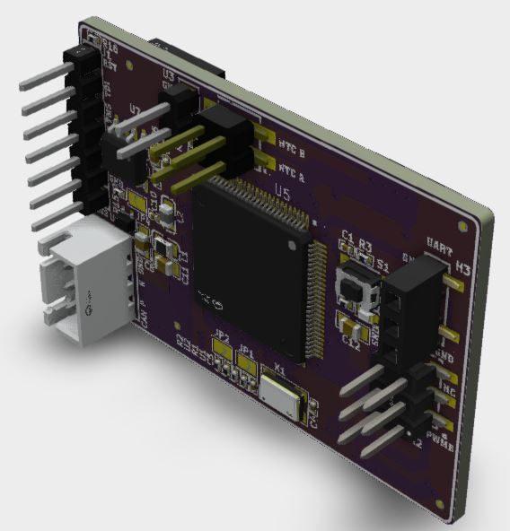

# Mechanical CAD

**PCB outline:** 47.6 × 32.3 mm (width × length, 1.6 mm 4-layer PCB). This is the nominal board footprint; verify the total assembly envelope (pin headers, CAN connector and the 1.27 mm board-to-board connectors on the bottom side) from the STEP model.

- [Download STEP 3D CAD model](SVX_MCU_F49C_KIT_001.step?raw=true)
- [View CAD rendering](SVX_MCU_F49C_KIT_001_CAD_3D_View.jpg)

[← Product home](../README.md)
